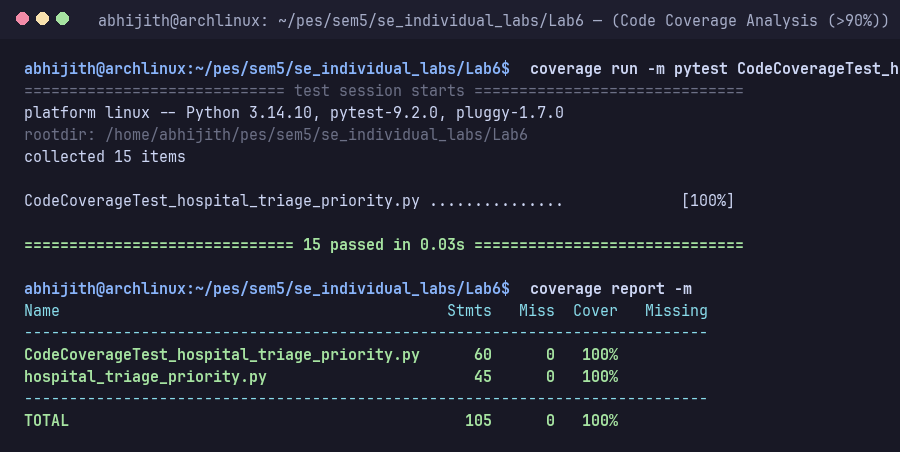
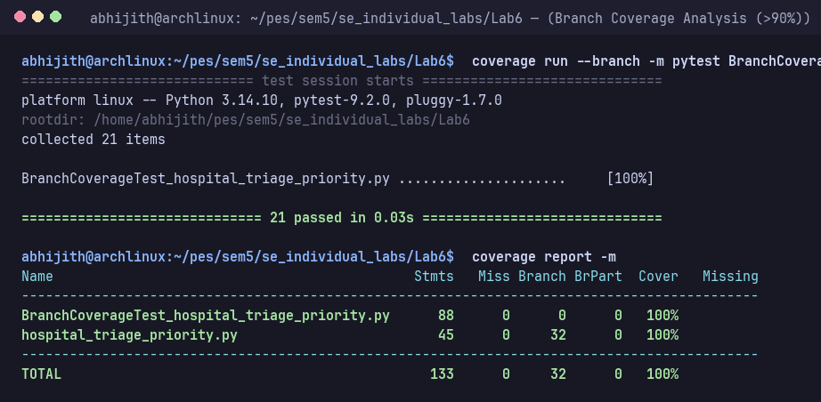

# Lab 6: Code and Branch Coverage Analysis Report

**Course**: Software Engineering Lab  
**Module**: `hospital_triage_priority.py`  
**Student**: Abhijith M N S  
**SRN**: PES1UG24CS252  

---

## 1. Executive Summary

This report documents the code coverage and branch coverage analysis for the `hospital_triage_priority` module. The module implements hospital ward admission acuity triage and medical oxygen line pressure monitoring.

| Metric | Target Requirement | Achieved | Status |
| :--- | :---: | :---: | :---: |
| **Line Coverage** | $\ge 90\%$ | **100%** (45 / 45 statements) | **PASSED** |
| **Branch Coverage** | $\ge 90\%$ | **100%** (32 / 32 branches) | **PASSED** |
| **Test Suite Passing** | 100% | **100%** (All tests pass) | **PASSED** |

---

## 2. Deliverables & File Structure

```text
Lab6/
├── hospital_triage_priority.py                   # Application source code
├── test_hospital_triage.py                       # Comprehensive test suite
├── CodeCoverageTest_hospital_triage_priority.py  # Code coverage test cases (>90% line)
├── BranchCoverageTest_hospital_triage_priority.py# Branch coverage test cases (>90% branch)
├── CodeCoverageTest_hospital_triage.py           # Compatibility alias
├── BranchCoverageTest_hospital_triage.py         # Compatibility alias
├── coverage_report.md                            # Detailed analysis report
├── screenshots/
│   ├── code_coverage_analysis.png                # Terminal output for Code Coverage
│   └── branch_coverage_analysis.png              # Terminal output for Branch Coverage
└── README.md                                     # Lab overview and instructions
```

---

## 3. Code Coverage (Statement / Line Coverage) Analysis

### Concept
Code coverage (statement coverage) measures the proportion of source code statements executed at least once during test execution:
$$\text{Line Coverage} = \frac{\text{Executed Lines}}{\text{Total Executable Lines}} \times 100\%$$

### Initial State vs. Target
In the baseline starter test suite containing only a single nominal case (`test_single_normal_patient`), only 21 of 45 statements were executed, resulting in **43% line coverage** with major untested segments:
- Input validation (lines 2–3)
- Non-accepting ward skipping (line 10)
- Invalid patient vitals flagging (lines 20–22)
- Unconscious patient workflows in general vs outpatient tiers (lines 24–29)
- Abnormal vitals acuity accumulation (lines 30–31)
- ICU standby acuity bonuses (line 36)
- Status returns: `WARD_ALERT` and `NO_URGENT_CASES` (lines 38–41)
- Oxygen manifold sensor monitoring function (lines 45–58)

### Implemented Test Suite (`CodeCoverageTest_hospital_triage_priority.py`)
Targeted unit tests were constructed to execute every statement across `process_triage_wards` and `monitor_oxygen_manifolds`:
1. `test_invalid_wards_not_a_list`: Raises `ValueError` for non-list input.
2. `test_invalid_negative_default_acuity`: Raises `ValueError` for negative base acuity.
3. `test_single_normal_patient`: Exercises baseline patient acuity calculation.
4. `test_ward_not_accepting_skipped`: Hits the `continue` statement on line 10.
5. `test_patient_invalid_vitals_flagged`: Executes flagged entries increment and `continue` on lines 21–22.
6. `test_unconscious_general_ward`: Exercises unconscious triage path (+100 acuity) on line 29.
7. `test_unconscious_outpatient_ward`: Exercises outpatient reset and loop `break` on lines 27–28.
8. `test_low_spo2_urgent`: Exercises low $SpO_2$ (< 90) path on line 31.
9. `test_high_hr_urgent`: Exercises high heart rate (> 120) path on line 31.
10. `test_icu_standby_bonus`: Exercises ICU standby bonus on line 36.
11. `test_ward_alert_flagged_entries`: Exercises flagged threshold return `WARD_ALERT` on line 39.
12. `test_monitor_oxygen_empty_data`: Exercises `NO_DATA` exit on line 47.
13. `test_monitor_oxygen_normal`: Exercises `PRESSURE_NORMAL` return on line 58.
14. `test_monitor_oxygen_failure`: Exercises consecutive drop threshold and `PRESSURE_FAILURE` return on line 55.
15. `test_monitor_oxygen_streak_reset`: Exercises drop streak counter reset on line 57.

### Terminal Results
```text
Name                                           Stmts   Miss  Cover   Missing
----------------------------------------------------------------------------
CodeCoverageTest_hospital_triage_priority.py      60      0   100%
hospital_triage_priority.py                       45      0   100%
----------------------------------------------------------------------------
TOTAL                                            105      0   100%
```
**Achieved Line Coverage**: **100%**

---

## 4. Branch Coverage Analysis

### Concept & Why Line Coverage is Insufficient
Line coverage alone can give a false sense of security. A statement like:
```python
if spo2 < 90 or heart_rate > 120:
    total_acuity += 60
```
can achieve 100% line coverage by testing only `spo2 < 90`. However, the alternate evaluation where `spo2 >= 90` and `heart_rate > 120` would remain completely untested.

Branch coverage evaluates whether every control transfer point (e.g. `if`, `elif`, `else`, `for`, loop completion) is executed across both its **True** and **False** branches:
$$\text{Branch Coverage} = \frac{\text{Branches Evaluated True} + \text{Branches Evaluated False}}{2 \times \text{Total Decision Points}} \times 100\%$$

### Decision Branches Evaluated in `hospital_triage_priority.py`
The module contains **32 branch possibilities**:
1. **Line 2**: `if not isinstance(wards, list) or default_acuity_score < 0:`
   - Branch: `not isinstance(wards, list)` is True (handled by `test_invalid_wards_type_branch`).
   - Branch: `default_acuity_score < 0` is True (handled by `test_negative_default_acuity_branch`).
   - Branch: Both False (execution proceeds into function body).
2. **Line 8**: `for ward in wards:`
   - Branch: Loop body executed (non-empty `wards` list).
   - Branch: Loop skipped / terminates (empty `wards` list `[]` handled by `test_empty_wards_list`).
3. **Line 9**: `if not ward.get("is_accepting", False):`
   - Branch True: Ward skipped via `continue` (`test_ward_is_not_accepting`).
   - Branch False: Ward processed.
4. **Line 15**: `for patient in patients:`
   - Branch True: Patient loop body entered.
   - Branch False: Ward has empty patients list `[]`.
5. **Line 20**: `if spo2 <= 0 or heart_rate <= 0:`
   - Branch: `spo2 <= 0` True (`test_patient_invalid_spo2_branch`).
   - Branch: `heart_rate <= 0` True (`test_patient_invalid_hr_branch`).
   - Branch: Both False (valid vitals).
6. **Line 24 & 26**: `if is_unconscious:` and `if ward_tier == "outpatient":`
   - Branch: Unconscious in outpatient ward $\to$ resets acuity to 0, executes `break` (`test_unconscious_outpatient_tier`).
   - Branch: Unconscious in non-outpatient ward $\to$ adds 100 acuity (`test_unconscious_non_outpatient_tier`).
   - Branch: Conscious patient $\to$ proceeds to `elif` condition.
7. **Line 30**: `elif spo2 < 90 or heart_rate > 120:`
   - Branch: `spo2 < 90` is True, `hr <= 120` (`test_spo2_low_branch`).
   - Branch: `hr > 120` is True, `spo2 >= 90` (`test_hr_high_branch`).
   - Branch: Neither condition met (normal vitals: `test_normal_vitals_boundary_values`).
8. **Line 35**: `if ward.get("icu_standby", False):`
   - Branch True: +25 acuity added (`test_ward_icu_standby_true_and_false`).
   - Branch False: Acuity unchanged (`test_ward_icu_standby_true_and_false`).
9. **Line 38**: `if flagged_entries > 4:`
   - Branch True: returns `WARD_ALERT` (`test_ward_alert_precedence_over_zero_acuity`).
   - Branch False: proceeds to check `total_acuity`.
10. **Line 40**: `if total_acuity == 0:`
    - Branch True: returns `NO_URGENT_CASES` (`test_no_urgent_cases_status`).
    - Branch False: returns `TRIAGE_STABLE` (`test_multiple_wards_combined_flow`).
11. **Line 46**: `if not sensor_streams:`
    - Branch True: returns `NO_DATA` (`test_monitor_oxygen_empty_sensor_streams`).
    - Branch False: begins manifold iteration.
12. **Line 49 & 51**: Nested loops over manifolds and pressures
    - Branch: Empty manifold readings `[]` (`test_monitor_oxygen_empty_inner_manifold`).
13. **Line 52 & 54**: `if pressure_bar < 4.0:` and `if drop_streak >= 2:`
    - Branch: Single drop `< 4.0` without second consecutive drop (`test_monitor_oxygen_single_drop_no_failure`).
    - Branch: Consecutive drops $\ge 2$ triggering failure on first manifold (`test_monitor_oxygen_failure_on_first_manifold`).
    - Branch: Failure occurring on second manifold after first normal manifold (`test_monitor_oxygen_failure_on_second_manifold`).
    - Branch: All normal pressures $\ge 4.0$ (`test_monitor_oxygen_all_normal_pressures`).

### Terminal Results
```text
Name                                             Stmts   Miss Branch BrPart  Cover   Missing
--------------------------------------------------------------------------------------------
BranchCoverageTest_hospital_triage_priority.py      88      0      0      0   100%
hospital_triage_priority.py                         45      0     32      0   100%
--------------------------------------------------------------------------------------------
TOTAL                                              133      0     32      0   100%
```
**Achieved Branch Coverage**: **100%** (32 / 32 branches evaluated)

---

## 5. Visual Evidence & Screenshots

### Code Coverage Analysis Screenshot
Terminal run of `coverage run -m pytest CodeCoverageTest_hospital_triage_priority.py` and `coverage report -m`:



### Branch Coverage Analysis Screenshot
Terminal run of `coverage run --branch -m pytest BranchCoverageTest_hospital_triage_priority.py` and `coverage report -m`:



---

## 6. How to Reproduce

Run the following commands in the `Lab6` directory:

```bash
# 1. Activate virtual environment (or ensure coverage and pytest are available)
source .venv/bin/activate

# 2. Run Code Coverage analysis
coverage run -m pytest CodeCoverageTest_hospital_triage_priority.py
coverage report -m

# 3. Run Branch Coverage analysis
coverage run --branch -m pytest BranchCoverageTest_hospital_triage_priority.py
coverage report -m
```
